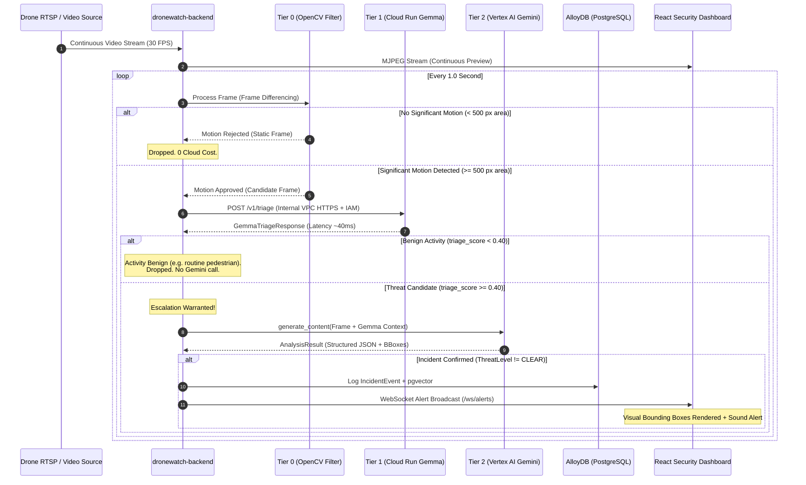

# DroneWatch Architecture Design Document
**System 1 Decision Framework: Calibrated Logprob Triage, Anti-Snowball Corroboration & Tier 2 Escalation**

- **Document Version:** 3.0.0
- **Status:** Approved Architecture Specification
- **Author:** Klara Lindermann, Staff Google Cloud Architect & Data Platform Engineer
- **Target Runtime:** Google Cloud Run, Vertex AI, AlloyDB for PostgreSQL

---

## 1. Executive Summary & Architectural Motivation

DroneWatch is an automated campus security surveillance and aerial threat detection system. Patrolling drones continuously ingest high-definition RTSP video feeds and archived GCS MP4 streams, screening for perimeter breaches, trespassing, unattended objects, unauthorized vehicles on walkways, and safety hazards.

### The Problem: Monolithic Vision Inference & Uncalibrated Keyword Heuristics
In Version 1.0, any video frame passing an OpenCV motion differencing threshold was forwarded directly to `gemini-3.6-flash` hosted on Vertex AI (~600ms–1,200ms round-trip latency and linear API cost scaling). Version 2.0 introduced a private Cloud Run Gemma 4 triage tier, which cut Gemini API volume by >93%—but relied on free-form text generation (`max_tokens=32`) and static keyword bucket heuristics (`0.05` / `0.80` / `0.90`) while sharing a single threshold across Tier 1 screening and Tier 2 operator sirens.

### The Solution: v3.0 System 1 Decision Framework
Version 3.0 upgrades the two-tier cascade into a **System 1 Decision Framework** inspired by constrained logprob decision engines (e.g., Jev) while preserving zero-egress VPC privacy and continuous HUD scene telemetry:
- **Tier 0 (Algorithmic Gate):** Local OpenCV Gaussian frame differencing filters out static background scenery (~2ms, zero cloud cost).
- **Tier 1 (Calibrated System 1 Vision Triage):** Private Cloud Run GPU service (`google/gemma-4-E2B-it` on NVIDIA RTX Pro 6000) executing single-token constrained choice (`SAFE` | `SUSPICIOUS` | `CRITICAL`) via vLLM `guided_choice` + `top_logprobs=10` in ~15ms–25ms. Exact softmax normalization yields calibrated posterior probabilities $P(\text{threat})$ and normalized Shannon entropy $H_{\text{norm}}$.
- **Deterministic Decision Engine (`DecisionEngine`):** Decouples raw model output from operational policy using 3-band routing (Band 0 Immediate Suppress, Band 1 $O(1)$ Non-Blocking $k\text{-of-}n$ Temporal Corroboration, Band 2 Immediate Escalate) plus strict **anti-snowball backpressure** (per-stream single-flight Tier 2 lock, configurable escalation cooldown, and monotonic video timestamp watermarks).
- **Tier 2 (Deep Contextual Reasoning & Decoupled Dispatch):** Escalated candidates route to `gemini-3.6-flash` on Vertex AI (or self-hosted Gemma 4 / `google/diffusiongemma-26B-A4B-it` on vLLM) and are evaluated against an independent `dispatch_confidence_threshold` before triggering operator alerts.

This architecture eliminates keyword negation bugs, prevents Tier 2 latency cascades during sustained campus activity, and maintains sub-2.0s end-to-end alerting for corroborated incidents.

---

## 2. End-to-End System Topology

```
┌────────────────────────────────────────────────────────────────────────────────────────────────────────┐
│                                       Google Cloud Project                                             │
│                                                                                                        │
│   ┌────────────────────────────────┐         ┌─────────────────────────────────────────────────────┐   │
│   │ IP Cameras / Drone RTSP Feeds  │         │ Artifact Registry (Docker Images)                   │   │
│   └───────────────┬────────────────┘         │ - dronewatch-backend:latest                         │   │
│                   │ RTSP / MP4               │ - dronewatch-gemma-triage:latest                    │   │
│                   ▼                          └──────────────────────────┬──────────────────────────┘   │
│   ┌────────────────────────────────┐                                    │                              │
│   │ Cloud Run: dronewatch-backend  │◄───────────────────────────────────┘                              │
│   │ (FastAPI + OpenCV + PyAV)      │                                                                   │
│   │                                │                                                                   │
│   │  ┌──────────────────────────┐  │                                                                   │
│   │  │ Tier 0: Motion Filter    │  │                                                                   │
│   │  │ (OpenCV Frame Diff)      │  │                                                                   │
│   │  └────────────┬─────────────┘  │                                                                   │
│   │               │ Motion Detected│ Internal VPC / IAM Auth                                           │
│   │               ▼                │ (Mutual TLS / OIDC Token)                                         │
│   │  ┌──────────────────────────┐  │ HTTPS POST /v1/triage                                             │
│   │  │ Triage Orchestrator      ├──┼──────────────────────┐                                            │
│   │  └────────────┬─────────────┘  │                      ▼                                            │
│   └───────────────┼────────────────┘     ┌─────────────────────────────────────────────────────────┐   │
│                   │                      │ Cloud Run: dronewatch-gemma-triage                      │   │
│                   │                      │ - Gemma 4 (google/gemma-4-E2B-it)                       │   │
│                   │                      │ - vLLM Serving (GCS FUSE mount)                         │   │
│                   │                      │ - 1x NVIDIA L4 GPU (24GB VRAM)                          │   │
│                   │                      │ - Ingress: Internal Only (No Public IP)                 │   │
│                   │                      └────────────────────────┬────────────────────────────────┘   │
│                   │ Escalation Warranted                          │ Triage Score & Tags                │
│                   │ (Threat Candidate)                            │ (Latency: ~40ms)                   │
│                   │                                               │                                    │
│                   ▼                                               ▼                                    │
│   ┌────────────────────────────────┐                     ┌─────────────────────────────────────────┐   │
│   │ Tier 2: Frontier Intelligence  ├────────────────────►│ Vertex AI (locations/global)            │   │
│   │ Gemini Escalator               │ HTTPS gRPC          │ Model: gemini-3.6-flash                 │   │
│   └───────────────┬────────────────┘                     │ Full contextual reasoning & bboxing     │   │
│                   │                                      └─────────────────────────────────────────┘   │
│                   │ Dispatches Validated Alert                                                         │
│                   ▼                                                                                    │
│   ┌────────────────────────────────┐                     ┌─────────────────────────────────────────┐   │
│   │ AlloyDB for PostgreSQL         │                     │ Cloud Storage (GCS)                     │   │
│   │ - Incident Events & pgvector   │                     │ - Video stream MP4 archives             │   │
│   │ - Zone polygon metadata        │                     │ - Incident JPEG crops                   │   │
│   └───────────────┬────────────────┘                     └─────────────────────────────────────────┘   │
│                   │ WebSocket /ws/alerts                                                               │
│                   ▼                                                                                    │
│   ┌────────────────────────────────┐                                                                   │
│   │ React / Vite Security Console  │                                                                   │
│   │ (Pilot & Dispatch Dashboard)   │                                                                   │
│   └────────────────────────────────┘                                                                   │
└────────────────────────────────────────────────────────────────────────────────────────────────────────┘
```

---

## 3. Tiered Inference Pipeline Specification

### Summary Comparison of Tiers

| Tier | Engine / Model | Infrastructure | Execution Budget | Primary Task | Drop Rate |
|---|---|---|---|---|---|
| **Tier 0** | OpenCV Differencing | Backend CPU | 2ms – 5ms | Background subtraction & noise rejection | 70% – 80% of all video frames |
| **Tier 1** | Gemma 4-E2B-it | Cloud Run (NVIDIA L4) | 35ms – 50ms | Rapid semantic classification & threat triage | 90% – 95% of motion frames |
| **Tier 2** | Gemini 3.6 Flash | Vertex AI Global | 600ms – 1,200ms | Zero-shot reasoning, bounding boxes, dispatch narrative | Target: < 5% of motion frames |

---

### Tier 0: Algorithmic Motion Gate
- **Algorithm:** Grayscale conversion $\to$ $21 \times 21$ Gaussian blur $\to$ Absolute frame differencing against previous frame ($I_t - I_{t-1}$) $\to$ Binary thresholding ($T=15$) $\to$ Contour area summation.
- **Gate Condition:**
  $$\text{HasMotion} = \sum_{c \in \text{Contours}} \text{Area}(c) \ge 500\,\text{px}$$
- **Responsibility:** Prevents running neural network inference on static scenery, sensor artifacts, or unchanged camera perspectives.

---

### Tier 1: Front-Line Triage Service (`dronewatch-gemma-triage`)
- **Model Choice:** `google/gemma-4-E2B-it` (Gemma 4 Native Multimodal Vision-Language Model).
  - *Architectural Rationale:* Gemma 4 natively integrates vision-language multimodal processing into the core model architecture (`Gemma4ForConditionalGeneration`), accepting both image pixels and text natively without requiring a separate vision adapter.
  - *Variable Token Budgeting:* Gemma 4 supports dynamic token budgeting for vision inputs (70, 140, 280, 560, 1120 tokens). For video stream triage, clamping the budget to 70–140 tokens provides low-overhead patch downsampling, sub-50ms inference, and minimal KV-cache memory footprint.
  - *Weight Provisioning:* Stored in Google Cloud Storage (`gs://jal-dronewatch-models/gemma-4-E2B-it`) synced from Google Vertex Model Garden (`gs://vertex-model-garden-public-us/gemma4/gemma-4-E2B-it/`) and mounted via Cloud Run Cloud Storage FUSE. Completely eliminates Hugging Face Hub dependencies, rate limits, and tokens.
- **Deployment Platform:** Google Cloud Run with GPU acceleration:
  - 1x NVIDIA RTX Pro 6000 or NVIDIA L4 GPU.
  - Sizing: up to 20 vCPUs, 80 GiB memory (or 8 vCPUs / 32 GiB for L4).
  - Runtime: Google-optimized container `us-docker.pkg.dev/vertex-ai/vertex-vision-model-garden-dockers/pytorch-vllm-serve:gemma4` serving the mounted model directory.
  - `--min-instances=0` to support scale-to-zero for maximum cost efficiency when drones are grounded.
- **Triage Prompt:**
  ```text
  detect campus security anomalies, unauthorized persons, or perimeter breaches; answer safe or alert
  ```
- **Triage Decision Boundary:**
  Tier 1 emits a `triage_score` $\in [0.0, 1.0]$ and detected class tags.
  - **CLEAR (`triage_score < 0.50` and no restricted tags):** Frame is dropped immediately. Drone stream status remains `ONLINE`. No external API calls are made.
  - **ESCALATE (`triage_score >= 0.50` or presence of high-risk tags):** The frame is forwarded to Tier 2 with the triage metadata context attached.

### Tier 1 Periodic Telemetry & HUD Scene Heartbeat (10-Second Cadence)
To provide positive visual confirmation to security operators that video feeds are actively undergoing AI scrutiny during tranquil intervals (where Tier 0 motion filtering would otherwise drop frames), the system implements a continuous 10-second heartbeat:
- **Trigger:** Unconditional bypass of the motion gate every `gemma_scene_description_interval_seconds` (10.0s).
- **Prompt:**
  ```text
  Describe this surveillance scene concisely in under 15 words. End with either SAFE or ALERT.
  ```
- **Terminal Verdict Parsing:** A strict terminal regex (`\b(safe|alert)[\.!]?$`) extracts the operator verdict while stripping the suffix from the natural language description.
- **Operator HUD Display:** If the verdict is `SAFE`, an `IncidentEvent` is emitted with `ThreatLevel.NONE` and `IncidentCategory.CLEAR`. The React HUD displays an emerald badge `Gemma 4 Triage (Routine Patrol)` alongside the 15-word summary.
- **AlloyDB Write Bypass:** To avoid write amplification (~360 rows/hr per drone), `broadcast_incident` in `main.py` streams these benign events directly over WebSocket (`/ws/alerts`) to active operators and bypasses database logging.
- **Cost Preservation:** Zero Gemini Flash API calls are triggered for benign heartbeats.

---

### Tier 2: Frontier Reasoning & Dispatch Escalation (`gemini-3.6-flash`)
- **Endpoint:** `locations/global/publishers/google/models/gemini-3.6-flash` via Google GenAI SDK.
- **Inputs:**
  1. High-resolution raw frame (JPEG).
  2. Tier 1 triage context (e.g., `Gemma flagged: potential vehicle on pedestrian walkway, score=0.68`).
  3. Structured prompt detailing campus security policies, zone definitions, and hazard classifications.
- **Output:** Validated Pydantic v2 `AnalysisResult`:
  - `suspicious_activity_detected: bool`
  - `threat_level: CLEAR | LOW | MEDIUM | HIGH | CRITICAL`
  - `category: PERIMETER_BREACH | LOITERING | UNATTENDED_OBJECT | TRAFFIC_VIOLATION | HAZARD | SUSPICIOUS_BEHAVIOR`
  - `summary: str` (1-sentence concise incident header)
  - `description: str` (natural language dispatch report)
  - `bounding_boxes: list[BoundingBox]` (normalized `[ymin, xmin, ymax, xmax]`)
- **Persistence & Broadcast:**
  - Persisted to AlloyDB for PostgreSQL table `incident_events` with vector embedding.
  - Real-time event broadcast to connected WebSockets (`/ws/alerts`).

---

## 4. Service Contracts & Data Schemas

All inter-service models are strictly typed using Pydantic v2 with `extra="forbid"`.

### Tier 1 Triage Request (`GemmaTriageRequest`)
```python
from pydantic import BaseModel, ConfigDict, Field


class GemmaTriageRequest(BaseModel):
    """Payload sent from Backend to Tier 1 Cloud Run Gemma Service."""

    model_config = ConfigDict(extra="forbid")

    drone_id: str = Field(..., description="Reporting drone identifier")
    zone_name: str = Field(..., description="Campus zone name")
    image_base64: str = Field(..., description="Base64 encoded JPEG video frame")
    triage_prompt: str = Field(
        default="detect security incident, unauthorized vehicle, perimeter breach, loitering, hazard",
        description="Detection prompt or classification target",
    )
```

### Tier 1 Triage Response (`GemmaTriageResponse`)
```python
from pydantic import BaseModel, ConfigDict, Field


class GemmaTriageResponse(BaseModel):
    """Structured response from Tier 1 Gemma 4 triage service."""

    model_config = ConfigDict(extra="forbid")

    is_threat_candidate: bool = Field(
        ..., description="True if frame requires Tier 2 Gemini evaluation"
    )
    triage_score: float = Field(
        ..., ge=0.0, le=1.0, description="Confidence of suspicious activity"
    )
    detected_tags: list[str] = Field(
        default_factory=list,
        description="Detected entity tags e.g. ['vehicle_on_walkway', 'pedestrian']",
    )
    inference_latency_ms: float = Field(
        ..., description="Execution duration inside Gemma container"
    )
    suggested_focus: str | None = Field(default=None, description="Contextual cue passed to Gemini")
    scene_description: str | None = Field(
        default=None, description="Concise routine surveillance description (< 15 words)"
    )
```

---

## 5. Sequence Flow & Triage Decision Logic



---

## 6. Google Cloud Infrastructure & Network Architecture

### Cloud Run Service Specifications

#### 1. Backend Service (`dronewatch-backend`)
- **Runtime:** Python 3.12, FastAPI, Uvicorn, OpenCV, PyAV.
- **Sizing:** 2 vCPU, 4 GiB RAM.
- **Scaling:** `--min-instances=1`, `--max-instances=10`.
- **Egress:** Direct VPC Egress (`--network=dronewatch-vpc-prod`, `--subnet=dronewatch-subnet-us-central1-prod`, `--vpc-egress=all-traffic`).
- **Ingress:** External (Public HTTPS for security console and RTSP ingest).

#### 2. Gemma Inference Service (`dronewatch-gemma-triage`)
- **Runtime:** vLLM container serving `google/gemma-4-E2B-it` via GCS FUSE mount.
- **GPU Accelerator:** 1x NVIDIA RTX Pro 6000 (`--gpu=1 --gpu-type=nvidia-rtx-pro-6000`) or NVIDIA L4 (`--gpu-type=nvidia-l4`).
- **Sizing:** 20 vCPU, 80 GiB RAM (or 8 vCPU, 32 GiB RAM for L4).
- **Scaling:** `--min-instances=0` (scale-to-zero during quiet hours / grounded patrols), `--max-instances=1` (or 4).
- **Ingress:** `--ingress=internal` (Strictly internal to the VPC and Cloud Run callers).
- **Authentication:** `--no-allow-unauthenticated`. IAM authentication required.

### IAM Least-Privilege Architecture
DroneWatch enforces strict separation of concerns across Google Cloud Service Accounts:

| Service Account | Role Bindings | Purpose |
|---|---|---|
| `sa-dronewatch-backend@...` | `roles/run.invoker` on `dronewatch-gemma-triage` | Allows backend to call internal Gemma triage endpoint |
| `sa-dronewatch-backend@...` | `roles/aiplatform.user` | Grants permission to invoke Vertex AI Gemini models |
| `sa-dronewatch-backend@...` | `roles/alloydb.client` | Access to AlloyDB PostgreSQL cluster |
| `sa-dronewatch-backend@...` | `roles/storage.objectAdmin` on snapshot buckets | Uploads JPEG incident evidence crops |
| `sa-dronewatch-gemma@...` | `roles/storage.objectViewer` on model buckets | Downloads model checkpoints if cached on GCS |

---

## 7. Cost & Latency Benchmark Analysis

### Workload Assumptions: 4-Drone Continuous Campus Patrol
- Streams: 4 active drone streams operating 24 hours/day.
- Ingestion Sampling: 1 evaluation frame per second per stream.
- Total Incoming Evaluation Frames: $4 \times 1 \times 3,600 \times 24 = 345,600\text{ frames/day}$.
- Motion Filter Rejection Rate (Tier 0): 75% static frames rejected $\implies 86,400\text{ motion frames/day}$.
- Gemma Benign Rejection Rate (Tier 1): 95% of motion frames are benign $\implies 4,320\text{ escalation frames/day}$ (5%).

### Monthly Cost Comparison (USD)

| Cost Component | Baseline (Single-Tier Gemini 3.6 Flash) | Enhanced (Two-Tier: Gemma + Gemini) | Variance |
|---|---|---|---|
| **Tier 0 (OpenCV Motion)** | \$0.00 (Local CPU) | \$0.00 (Local CPU) | \$0.00 |
| **Tier 1 (Gemma 4 on Cloud Run)** | N/A | ~\$470.00 (1x L4 GPU instance continuous serving) | +\$470.00 |
| **Tier 2 (Gemini 3.6 Flash API)** | \$388.80 (86,400 calls/day @ \$0.00015/call) | \$19.44 (4,320 calls/day @ \$0.00015/call) | **-95.0% (-\$369.36)** |
| **Fleet Scale at 16 Drones** | **\$1,555.20 / month** | **\$547.76 / month** | **-64.8% (-\$1,007.44)** |
| **Fleet Scale at 32 Drones** | **\$3,110.40 / month** | **\$625.52 / month** | **-79.9% (-\$2,484.88)** |

> [!IMPORTANT]
> **Sub-Linear Cost Scaling:** In the single-tier architecture, every added drone increases Gemini API costs linearly. In the two-tier architecture, Gemma on Cloud Run processes high-concurrency frame batches on a fixed GPU footprint. The marginal cost of adding drones is near-zero until GPU saturation, while Gemini API costs remain strictly confined to actual security anomalies. With `--min-instances=0`, idle overnight or intermittent drone missions incur \$0 for Gemma GPU hours when offline.

### Latency Profiles
- **Routine Benign Frame:**
  - Baseline: 800ms–1,200ms (waited on full Gemini round trip).
  - Two-Tier: **38ms** (OpenCV 3ms + Cloud Run Gemma 4 35ms). Frame dismissed instantly.
- **Actual Security Threat Frame:**
  - Baseline: 900ms.
  - Two-Tier: **940ms** (Gemma 40ms triage + Gemini 900ms deep extraction). Fully compliant with the < 2.0s real-time alert SLA.

---

## 8. Circuit Breakers, Failure Modes & Resilience

The multi-tier architecture implements robust resilience patterns to guarantee surveillance integrity:

1. **Gemma Service Degradation (Circuit Breaker):**
   - If the Tier 1 Cloud Run service returns HTTP 5xx errors or times out (`timeout > 2.0s`), the backend trips the circuit breaker to fail open.
   - **Fail-Open Policy:** When the circuit is open, motion-detected frames bypass Tier 1 and route directly to Gemini 3.6 Flash. Surveillance is never blind during model service updates or restarts.
   - **Automatic Healing:** When Gemma resumes returning `200 OK`, the client logs an informational recovery event and seamlessly re-engages Tier 1 triage.
2. **Scale-to-Zero (`min-instances=0`) Cold-Start Mitigation:**
   - To eliminate idle GPU billing, the Gemma triage service supports scale-to-zero.
   - During container wakeups (~35s–45s for model initialization from GCS FUSE), the backend circuit breaker catches incoming request timeouts and fails open to Gemini Flash. This ensures zero frames are dropped and video streams continue uninterrupted while the GPU warms up.
3. **Vertex AI Quota Exhaustion:**
   - If Tier 2 Gemini returns HTTP 429 (Resource Exhausted), the system records the Tier 1 detection tags and logs an unclassified `MEDIUM` alert into AlloyDB with the local snapshot, preventing incident loss.

---

## 9. Observability & Cloud Logging Architecture

DroneWatch provides full visibility into Tier 1 Gemma inference without bloating Cloud Logging with large base64 image strings.

### Structured Logging Specification
The `GemmaTriageClient` logs every inference cycle at `INFO` level with structured key-value telemetry:
```text
INFO: Tier 1 Gemma vision triage [drone-alpha]: prompt='detect campus security anomalies...' | response='SAFE' | verdict=BENIGN score=0.05 tags=['safe'] (latency=41.2ms)
```

### Cloud Logging Query Recipes
- **View All Gemma Triage Inferences:**
  ```sql
  resource.type="cloud_run_revision"
  resource.labels.service_name="dronewatch-backend"
  textPayload=~"Tier 1 Gemma vision triage"
  ```
- **Inspect Escalations to Tier 2 Gemini:**
  ```sql
  resource.type="cloud_run_revision"
  resource.labels.service_name="dronewatch-backend"
  textPayload=~"verdict=ANOMALOUS" OR textPayload=~"verdict=SUSPICIOUS"
  ```
- **Audit Circuit Breaker State Transitions:**
  ```sql
  resource.type="cloud_run_revision"
  resource.labels.service_name="dronewatch-backend"
  textPayload=~"circuit breaker"
  ```

---

## 10. Implementation Roadmap & Milestones

1. **Phase 1: Gemma Cloud Run Containerization (Completed)**
   - Package `google/gemma-4-E2B-it` in Google Vertex Model Garden prebuilt vLLM container.
   - Provision model weights on GCS bucket (`jal-dronewatch-models`) and mount via Cloud Run GCS volume.
   - Deploy with scale-to-zero (`--min-instances=0`) and NVIDIA GPU acceleration.
2. **Phase 2: Backend Client, Circuit Breaker & Telemetry (Completed)**
   - Implement `GemmaTriageClient` with Google OIDC authentication and fail-open resilience.
   - Implement 10-second HUD telemetry heartbeat for operator confirmation.
   - Validate with comprehensive pytest suite covering circuit breaker trip, recovery, and payload mocking.
3. **Phase 3: Dynamic Workflow Administration & Multimodal Model Agility (Completed)**
   - Implement dynamic workflow configuration engine with AlloyDB persistence (`workflow_config` table).
   - Support on-the-fly toggling between Gemini and Gemma for Tier 2 escalation without service restarts.
   - Support selectable Gemini escalation models (`gemini-3.8-flash`, `gemini-3.7-flash`, `gemini-3.6-flash`, `gemini-4-aragon`, and custom model identifiers).
   - Implement React Administration UI with real-time dirty state tracking and reset capabilities.
   - Stream HUD badges and Alert Log telemetry tracking origin tier (`triage`/`escalation`), model family, model identifier, and inference latency.
4. **Phase 4: System 1 Decision Framework & Anti-Snowball Corroboration (Completed — v3.0)**
   - Replace free-form keyword heuristics with vLLM `guided_choice` (`SAFE` | `SUSPICIOUS` | `CRITICAL`) and exact softmax calibration over `top_logprobs`.
   - Introduce deterministic `DecisionEngine` separating 3-band Tier 1 routing (`SUPPRESS`, `CORROBORATE_HOLD`, `ESCALATE_CORROBORATED`, `ESCALATE_IMMEDIATE`, `COOLDOWN_SKIP`) from decoupled Tier 2 dispatch policy (`dispatch_confidence_threshold`).
   - Guarantee non-cascading frame latency via $O(1)$ per-stream ring buffers, single-flight Tier 2 locks, configurable escalation cooldowns, and monotonic video timestamp watermarks (`STALE_WATERMARK_DROPPED`).
   - Add clause-scoped negation-safe fallback (`_strip_negated_clauses`) and selectable `google/diffusiongemma-26B-A4B-it` Tier 2 support.
   - Expand automated verification suite to 72 passing `pytest` tests with zero `ruff` warnings.

---

## 11. Dynamic Workflow Configuration & Administration Engine

### 11.1 Architectural Rationale
Operational campus environments require dynamic tuning of vision thresholds, triage prompts, and multimodal reasoning models without redeploying microservices or interrupting live RTSP video feeds. Version 2.2+ introduces the **Dynamic Workflow Configuration Engine**, extended in Version 3.0 with full System 1 Decision Framework controls across all active drone feeds in real time.

```
┌────────────────────────────────────────────────────────────────────────────────────────┐
│                                 Administration Console                                 │
│                                (React SPA AdminView.jsx)                               │
└───────────────────────────────────────────┬────────────────────────────────────────────┘
                                            │ PUT /api/admin/workflow-config
                                            ▼
┌────────────────────────────────────────────────────────────────────────────────────────┐
│                             FastAPI Workflow Config Router                             │
│                                                                                        │
│   ┌───────────────────────────┐                     ┌──────────────────────────────┐   │
│   │ WorkflowConfigUpdate      │                     │ Database Store (AlloyDB)     │   │
│   │ Pydantic Validation       ├────────────────────►│ table: workflow_settings     │   │
│   │ (extra="forbid")          │                     │ singleton row (id=1)         │   │
│   └─────────────┬─────────────┘                     └──────────────┬───────────────┘   │
│                 │                                                  │                   │
│                 │ Updates In-Memory Cache                          │ Persisted         │
│                 ▼                                                  ▼                   │
│   ┌────────────────────────────────────────────────────────────────────────────────┐   │
│   │ Dynamic Config Provider (Callable[[], Awaitable[WorkflowConfig]])              │   │
│   └───────────────────────────────────────┬────────────────────────────────────────┘   │
└───────────────────────────────────────────┼────────────────────────────────────────────┘
                                            │ Injected per evaluated frame
                                            ▼
┌────────────────────────────────────────────────────────────────────────────────────────┐
│                     DroneStreamProcessor + DecisionEngine (v3.0)                       │
│                                                                                        │
│   1. Resolve active WorkflowConfig                                                     │
│   2. Tier 1 Triage (GemmaTriageClient -> DecisionEngine.evaluate_tier1):               │
│      ├─► Band 0 (< suppress_threshold): SUPPRESS immediately                           │
│      ├─► Band 1 (ambiguous): O(1) k-of-n ring buffer -> CORROBORATE_HOLD / ESCALATE    │
│      └─► Band 2 (>= gemma_triage_threshold): ESCALATE_IMMEDIATE (single-flight gated)  │
│   3. Tier 2 Escalation Target (DecisionEngine.evaluate_tier2_dispatch):                │
│      ├─► GEMINI: Vertex AI GeminiVideoAnalyzer                                         │
│      └─► GEMMA:  Cloud Run vLLM (Gemma 4 or DiffusionGemma 26B-A4B)                    │
│   4. Broadcast IncidentEvent with routing_action, dispatch_action & latency_ms         │
└────────────────────────────────────────────────────────────────────────────────────────┘
```

### 11.2 AlloyDB Schema Specification
Configuration settings and decision audit fields are persisted in AlloyDB:

```sql
CREATE TABLE IF NOT EXISTS workflow_settings (
    id INT PRIMARY KEY DEFAULT 1 CHECK (id = 1),
    enable_tier1_gemma BOOLEAN NOT NULL DEFAULT TRUE,
    triage_mode VARCHAR(32) NOT NULL DEFAULT 'DECISION_FRAMEWORK',
    escalation_target VARCHAR(32) NOT NULL DEFAULT 'GEMINI',
    suppress_threshold DOUBLE PRECISION NOT NULL DEFAULT 0.25,
    gemma_triage_threshold DOUBLE PRECISION NOT NULL DEFAULT 0.50,
    dispatch_confidence_threshold DOUBLE PRECISION,
    corroboration_hits INT NOT NULL DEFAULT 2,
    corroboration_window INT NOT NULL DEFAULT 3,
    escalation_cooldown_seconds DOUBLE PRECISION NOT NULL DEFAULT 3.0,
    gemma_triage_prompt TEXT NOT NULL,
    gemini_escalation_prompt TEXT NOT NULL,
    gemma_escalation_prompt TEXT NOT NULL,
    gemini_model VARCHAR(64) NOT NULL DEFAULT 'gemini-3.6-flash',
    gemma_model VARCHAR(64) NOT NULL DEFAULT 'google/gemma-4-E2B-it',
    gemma_service_url VARCHAR(256),
    gemma_timeout_seconds DOUBLE PRECISION NOT NULL DEFAULT 2.0,
    alert_keywords JSONB NOT NULL DEFAULT '[]'::jsonb,
    benign_keywords JSONB NOT NULL DEFAULT '[]'::jsonb,
    ambiguity_policy VARCHAR(32) NOT NULL DEFAULT 'FAIL_SAFE',
    vllm_temperature DOUBLE PRECISION NOT NULL DEFAULT 0.0,
    vllm_max_tokens INT NOT NULL DEFAULT 32,
    version INT NOT NULL DEFAULT 1,
    updated_by VARCHAR(64) NOT NULL DEFAULT 'pilot-admin',
    updated_at TIMESTAMPTZ NOT NULL DEFAULT NOW()
);

CREATE TABLE IF NOT EXISTS workflow_settings_history (
    id SERIAL PRIMARY KEY,
    version INT NOT NULL,
    settings JSONB NOT NULL,
    created_at TIMESTAMPTZ NOT NULL DEFAULT NOW()
);
```

### 11.3 Dynamic Model Resolution Matrix

| Target Config | Active Engine | Model Identifier | Prompt Applied | Fallback / Failure Mode |
|---|---|---|---|---|
| `escalation_target=GEMINI`, `gemini_model=gemini-3.8-flash` | Vertex AI Gemini | `gemini-3.8-flash` | `gemini_escalation_prompt` | Falls back to default model list or logs structured alert |
| `escalation_target=GEMINI`, `gemini_model=gemini-3.7-flash` | Vertex AI Gemini | `gemini-3.7-flash` | `gemini_escalation_prompt` | Falls back to default model list or logs structured alert |
| `escalation_target=GEMINI`, `gemini_model=gemini-3.6-flash` | Vertex AI Gemini | `gemini-3.6-flash` | `gemini_escalation_prompt` | Default production model |
| `escalation_target=GEMINI`, `gemini_model=gemini-4-aragon` | Vertex AI Gemini | `gemini-4-aragon` | `gemini_escalation_prompt` | Next-generation multimodal model |
| `escalation_target=GEMMA`, `gemma_model=google/gemma-4-E2B-it` | Cloud Run GPU | `google/gemma-4-E2B-it` | `gemma_escalation_prompt` | Fail-open circuit breaker to Gemini Flash if GPU unavailable |
| `escalation_target=GEMMA`, `gemma_model=google/diffusiongemma-26B-A4B-it` | Cloud Run GPU | `google/diffusiongemma-26B-A4B-it` | `gemma_escalation_prompt` | Parallel block-denoising MoE JSON generation (~3x–5x faster structured output) |

### 11.4 Gemma & DiffusionGemma as Tier 2 Deep Inspection Models
When configured for self-hosted escalation (`escalation_target=GEMMA`), `GemmaTriageClient.deep_analyze_frame()` directs the model (`google/gemma-4-E2B-it` or `google/diffusiongemma-26B-A4B-it`) to output a strictly compliant JSON schema matching Pydantic `AnalysisResult`:

```json
{
  "suspicious_activity_detected": true,
  "threat_level": "HIGH",
  "category": "PERIMETER_BREACH",
  "summary": "Concise scene summary",
  "description": "Detailed explanation of visual observations",
  "confidence_score": 0.88,
  "bounding_boxes": [
    {"ymin": 0.25, "xmin": 0.35, "ymax": 0.75, "xmax": 0.65, "label": "person"}
  ]
}
```

Threat alerts are gated on `confidence_score >= effective_dispatch_threshold` (`dispatch_confidence_threshold` if configured, else `gemma_triage_threshold`), allowing sensitive Tier 1 screening without noisy operator sirens.

### 11.5 Clause-Scoped Negation Safety for Uncalibrated / Heartbeat Fallback
`DECISION_FRAMEWORK` is the sole supported Tier 1 evaluation mode (`KEYWORD_LEGACY` has been retired). When evaluating 10-second natural-language scene heartbeats (`request_scene_description=True`) or if an endpoint omits `top_logprobs`, `GemmaTriageClient._strip_negated_clauses()` splits text along punctuation and contrastive conjunction boundaries (`but`, `however`, `except`, `yet`, `although`, `while`) before stripping negated clauses (`"no hazards or unauthorized vehicles"`). This eliminates false-positive escalations on benign negated statements while preserving true alerts after contrastive clauses (`"No fire visible, but an intruder is climbing the fence"`).

### 11.6 Observability & Telemetry Audit Contract
Every evaluated frame and security incident publishes full attribution metadata across WebSockets, AlloyDB, and Cloud Logging:

- `source_tier`: Analysis tier producing the verdict (`"triage"` or `"escalation"`).
- `source_model`: Model family (`"gemma"` or `"gemini"`).
- `model_name`: Full model identifier string (e.g., `"gemini-3.6-flash"` or `"google/gemma-4-E2B-it"`).
- `routing_action`: Deterministic Tier 1 `DecisionEngine` transition (`"SUPPRESS"`, `"CORROBORATE_HOLD"`, `"ESCALATE_CORROBORATED"`, `"ESCALATE_IMMEDIATE"`, `"COOLDOWN_SKIP"`, `"CIRCUIT_BREAKER_BYPASS"`).
- `dispatch_action`: Deterministic Tier 2 policy decision (`"ACTIVE_ALERT"`, `"SUPPRESSED_BELOW_POLICY"`, `"STALE_WATERMARK_DROPPED"`, `"CLEAR_ROUTINE"`).
- `scene_summary` / `raw_response` / `latency_ms`: Full operator and compliance trace.

---

## 12. System 1 Decision Framework & Anti-Snowball Architecture (v3.0)

### 12.1 Constrained Choice & Softmax Logprob Calibration
In `DECISION_FRAMEWORK` mode (`TriageMode.DECISION_FRAMEWORK`), `GemmaTriageClient` sends `max_tokens=3`, `temperature=0.0`, `logprobs=True`, `top_logprobs=10`, and `guided_choice=["SAFE", "SUSPICIOUS", "CRITICAL"]` to vLLM on the NVIDIA RTX Pro 6000 (`nvidia-rtx-pro-6000`, 20 vCPU / 80 GiB RAM).

Given first-position `top_logprobs` $\ell_c$ for $c \in \mathcal{C} = \{\text{SAFE}, \text{SUSPICIOUS}, \text{CRITICAL}\}$ (defaulting missing classes to $\ell_{\min} = -20.0$), exact calibrated class probabilities and normalized Shannon entropy are computed in Python:

$$P(c) = \frac{\exp(\ell_c - \ell_{\max})}{\sum_{k \in \mathcal{C}} \exp(\ell_k - \ell_{\max})}, \qquad P(\text{threat}) = P(\text{SUSPICIOUS}) + P(\text{CRITICAL})$$

$$H_{\text{norm}} = -\frac{1}{\ln 3} \sum_{c \in \mathcal{C}} P(c) \ln P(c) \in [0, 1]$$

### 12.2 Three-Band Routing & Non-Blocking Temporal Corroboration
`DecisionEngine.evaluate_tier1()` maps $(P(\text{threat}), H_{\text{norm}}, \text{verdict})$ into three operational bands:

| Band | Condition | Action (`RoutingAction`) | Behavior |
|---|---|---|---|
| **Band 0 (Suppress)** | $P(\text{threat}) < \tau_{\text{suppress}}$ (`0.25`) and low entropy | `SUPPRESS` | Immediate drop (~20ms); zero Tier 2 cost |
| **Band 1 (Corroborate)** | $\tau_{\text{suppress}} \le P(\text{threat}) < \tau_{\text{escalate}}$ (`0.50`) or high entropy ($H_{\text{norm}} \ge 0.72$ under `FAIL_SAFE`) | `CORROBORATE_HOLD` / `ESCALATE_CORROBORATED` | Appends observation to $O(1)$ per-stream `deque(maxlen=n)` and returns immediately; escalates once $k\text{-of-}n$ (`2-of-3`) frames corroborate |
| **Band 2 (Immediate)** | $P(\text{threat}) \ge \tau_{\text{escalate}}$ (`0.50`) or `verdict == CRITICAL` | `ESCALATE_IMMEDIATE` | Escalates on the very first frame |

### 12.3 Anti-Snowball Backpressure Guarantees
To ensure the 2.0s corroboration SLA never cascades or stalls live MJPEG feeds during sustained campus motion:

1. **Zero-Sleep Ring Buffer:** `CORROBORATE_HOLD` never awaits future frames or holds concurrency semaphores; each 1 FPS evaluation tick completes in ~20ms.
2. **Per-Stream Single-Flight Lock (`tier2_in_flight`) & Cooldown (`escalation_cooldown_seconds`):** While a 900ms Tier 2 call is in flight—or within the 3.0s post-escalation cooldown window—subsequent non-`CRITICAL` escalations return `COOLDOWN_SKIP` instead of piling up queued Vertex AI requests. Genuine `CRITICAL` spikes ($P(\text{CRITICAL}) \ge 0.50$) bypass cooldown immediately.
3. **Monotonic Video Timestamp Watermark (`last_dispatched_video_ts`):** `DecisionEngine.evaluate_tier2_dispatch()` drops any out-of-order Tier 2 completion whose video timestamp precedes an already-dispatched alert (`STALE_WATERMARK_DROPPED`), guaranteeing strictly monotonic HUD alerts.


