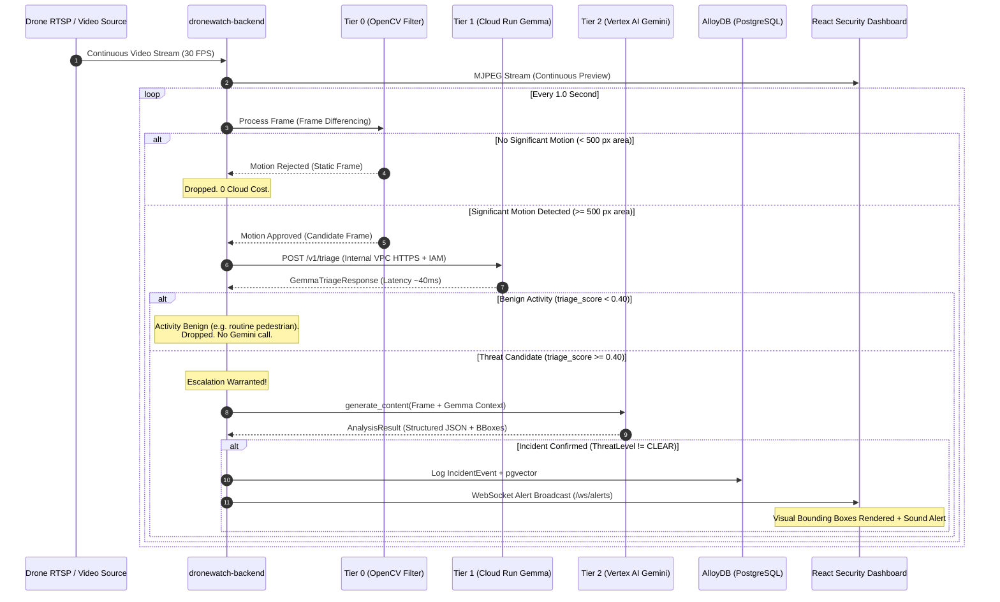

# DroneWatch Architecture Design Document
**Hierarchical Two-Tier AI Inference: Front-Line Gemma Triage & Gemini Escalation**

- **Document Version:** 2.2.0
- **Status:** Approved Architecture Specification
- **Author:** Klara Lindermann, Staff Google Cloud Architect & Data Platform Engineer
- **Target Runtime:** Google Cloud Run, Vertex AI, AlloyDB for PostgreSQL

---

## 1. Executive Summary & Architectural Motivation

DroneWatch is an automated campus security surveillance and aerial threat detection system. Patrolling drones continuously ingest high-definition RTSP video feeds and archived GCS MP4 streams, screening for perimeter breaches, trespassing, unattended objects, unauthorized vehicles on walkways, and safety hazards.

### The Problem: Monolithic Vision Inference at Scale
In Version 1.0, any video frame passing an OpenCV motion differencing threshold is forwarded directly to `gemini-3.6-flash` hosted on Vertex AI. While `gemini-3.6-flash` delivers outstanding zero-shot reasoning and high-precision bounding box extraction, routing all moving frames to a frontier multimodal model introduces critical architectural inefficiencies:

1. **Economic Inefficiency (Unbounded API Costs):** In continuous 24/7 surveillance, over 95% of motion-triggered frames are benign (swaying branches, shifting cloud shadows, birds, authorized ground maintenance crews, or routine pedestrians on designated walkways). Paying frontier token rates to repeatedly classify empty lawns or trees is a failure of cloud engineering stewardship.
2. **Quota & Rate-Limiting Pressure:** Scaling from 4 drones to 16+ drones creates high burst volumes against Vertex AI regional quotas during windy conditions or class change intervals.
3. **Latency Profile:** Frontier multimodal inference over external endpoints exhibits a round-trip latency of 600ms–1,200ms. For benign frames, this creates unnecessary worker queue backpressure.

### The Solution: Two-Tier Hierarchical Inference
Version 2.0 establishes a **Two-Tier (Cascade) Inference Architecture**:
- **Tier 0 (Algorithmic Gate):** Local OpenCV Gaussian frame differencing filters out sensor noise and static scenery (~2ms, zero cloud cost).
- **Tier 1 (Front-Line Vision Triage):** A private Google Cloud Run microservice running Google's open vision-language model **Gemma 4** (`gemma-4-E2B-it`). Operating on an NVIDIA L4 GPU, it performs binary/tri-state triage in 35ms–50ms using Gemma 4's native visual understanding and low-overhead token budgeting (70–140 tokens). Frames deemed normal/benign are dropped immediately.
- **Tier 2 (Deep Contextual Reasoning & Dispatch):** Only frames flagged as suspicious, anomalous, or ambiguous by Tier 1 are escalated to `gemini-3.6-flash` on Vertex AI. Gemini generates full threat narratives, bounding boxes, severity classifications, and alerts for dispatch.

This cascade reduces Gemini API consumption by **93%–97%**, guarantees deterministic cost scaling as drone fleets expand, and maintains sub-second end-to-end alerting for genuine security incidents.

---

## 2. End-to-End System Topology

```
┌────────────────────────────────────────────────────────────────────────────────────────────────────────┐
│                                       Google Cloud Project                                             │
│                                                                                                        │
│   ┌────────────────────────────────┐         ┌─────────────────────────────────────────────────────┐   │
│   │ IP Cameras / Drone RTSP Feeds  │         │ Artifact Registry (Docker Images)                   │   │
│   └───────────────┬────────────────┘         │ - dronewatch-backend:latest                         │   │
│                   │ RTSP / MP4               │ - dronewatch-gemma-triage:latest                    │   │
│                   ▼                          └──────────────────────────┬──────────────────────────┘   │
│   ┌────────────────────────────────┐                                    │                              │
│   │ Cloud Run: dronewatch-backend  │◄───────────────────────────────────┘                              │
│   │ (FastAPI + OpenCV + PyAV)      │                                                                   │
│   │                                │                                                                   │
│   │  ┌──────────────────────────┐  │                                                                   │
│   │  │ Tier 0: Motion Filter    │  │                                                                   │
│   │  │ (OpenCV Frame Diff)      │  │                                                                   │
│   │  └────────────┬─────────────┘  │                                                                   │
│   │               │ Motion Detected│ Internal VPC / IAM Auth                                           │
│   │               ▼                │ (Mutual TLS / OIDC Token)                                         │
│   │  ┌──────────────────────────┐  │ HTTPS POST /v1/triage                                             │
│   │  │ Triage Orchestrator      ├──┼──────────────────────┐                                            │
│   │  └────────────┬─────────────┘  │                      ▼                                            │
│   └───────────────┼────────────────┘     ┌─────────────────────────────────────────────────────────┐   │
│                   │                      │ Cloud Run: dronewatch-gemma-triage                      │   │
│                   │                      │ - Gemma 4 (google/gemma-4-E2B-it)                       │   │
│                   │                      │ - vLLM Serving (GCS FUSE mount)                         │   │
│                   │                      │ - 1x NVIDIA L4 GPU (24GB VRAM)                          │   │
│                   │                      │ - Ingress: Internal Only (No Public IP)                 │   │
│                   │                      └────────────────────────┬────────────────────────────────┘   │
│                   │ Escalation Warranted                          │ Triage Score & Tags                │
│                   │ (Threat Candidate)                            │ (Latency: ~40ms)                   │
│                   │                                               │                                    │
│                   ▼                                               ▼                                    │
│   ┌────────────────────────────────┐                     ┌─────────────────────────────────────────┐   │
│   │ Tier 2: Frontier Intelligence  ├────────────────────►│ Vertex AI (locations/global)            │   │
│   │ Gemini Escalator               │ HTTPS gRPC          │ Model: gemini-3.6-flash                 │   │
│   └───────────────┬────────────────┘                     │ Full contextual reasoning & bboxing     │   │
│                   │                                      └─────────────────────────────────────────┘   │
│                   │ Dispatches Validated Alert                                                         │
│                   ▼                                                                                    │
│   ┌────────────────────────────────┐                     ┌─────────────────────────────────────────┐   │
│   │ AlloyDB for PostgreSQL         │                     │ Cloud Storage (GCS)                     │   │
│   │ - Incident Events & pgvector   │                     │ - Video stream MP4 archives             │   │
│   │ - Zone polygon metadata        │                     │ - Incident JPEG crops                   │   │
│   └───────────────┬────────────────┘                     └─────────────────────────────────────────┘   │
│                   │ WebSocket /ws/alerts                                                               │
│                   ▼                                                                                    │
│   ┌────────────────────────────────┐                                                                   │
│   │ React / Vite Security Console  │                                                                   │
│   │ (Pilot & Dispatch Dashboard)   │                                                                   │
│   └────────────────────────────────┘                                                                   │
└────────────────────────────────────────────────────────────────────────────────────────────────────────┘
```

---

## 3. Tiered Inference Pipeline Specification

### Summary Comparison of Tiers

| Tier | Engine / Model | Infrastructure | Execution Budget | Primary Task | Drop Rate |
|---|---|---|---|---|---|
| **Tier 0** | OpenCV Differencing | Backend CPU | 2ms – 5ms | Background subtraction & noise rejection | 70% – 80% of all video frames |
| **Tier 1** | Gemma 4-E2B-it | Cloud Run (NVIDIA L4) | 35ms – 50ms | Rapid semantic classification & threat triage | 90% – 95% of motion frames |
| **Tier 2** | Gemini 3.6 Flash | Vertex AI Global | 600ms – 1,200ms | Zero-shot reasoning, bounding boxes, dispatch narrative | Target: < 5% of motion frames |

---

### Tier 0: Algorithmic Motion Gate
- **Algorithm:** Grayscale conversion $\to$ $21 \times 21$ Gaussian blur $\to$ Absolute frame differencing against previous frame ($I_t - I_{t-1}$) $\to$ Binary thresholding ($T=15$) $\to$ Contour area summation.
- **Gate Condition:**
  $$\text{HasMotion} = \sum_{c \in \text{Contours}} \text{Area}(c) \ge 500\,\text{px}$$
- **Responsibility:** Prevents running neural network inference on static scenery, sensor artifacts, or unchanged camera perspectives.

---

### Tier 1: Front-Line Triage Service (`dronewatch-gemma-triage`)
- **Model Choice:** `google/gemma-4-E2B-it` (Gemma 4 Native Multimodal Vision-Language Model).
  - *Architectural Rationale:* Gemma 4 natively integrates vision-language multimodal processing into the core model architecture (`Gemma4ForConditionalGeneration`), accepting both image pixels and text natively without requiring a separate vision adapter.
  - *Variable Token Budgeting:* Gemma 4 supports dynamic token budgeting for vision inputs (70, 140, 280, 560, 1120 tokens). For video stream triage, clamping the budget to 70–140 tokens provides low-overhead patch downsampling, sub-50ms inference, and minimal KV-cache memory footprint.
  - *Weight Provisioning:* Stored in Google Cloud Storage (`gs://jal-dronewatch-models/gemma-4-E2B-it`) synced from Google Vertex Model Garden (`gs://vertex-model-garden-public-us/gemma4/gemma-4-E2B-it/`) and mounted via Cloud Run Cloud Storage FUSE. Completely eliminates Hugging Face Hub dependencies, rate limits, and tokens.
- **Deployment Platform:** Google Cloud Run with GPU acceleration:
  - 1x NVIDIA RTX Pro 6000 or NVIDIA L4 GPU.
  - Sizing: up to 20 vCPUs, 80 GiB memory (or 8 vCPUs / 32 GiB for L4).
  - Runtime: Google-optimized container `us-docker.pkg.dev/vertex-ai/vertex-vision-model-garden-dockers/pytorch-vllm-serve:gemma4` serving the mounted model directory.
  - `--min-instances=0` to support scale-to-zero for maximum cost efficiency when drones are grounded.
- **Triage Prompt:**
  ```text
  detect campus security anomalies, unauthorized persons, or perimeter breaches; answer safe or alert
  ```
- **Triage Decision Boundary:**
  Tier 1 emits a `triage_score` $\in [0.0, 1.0]$ and detected class tags.
  - **CLEAR (`triage_score < 0.50` and no restricted tags):** Frame is dropped immediately. Drone stream status remains `ONLINE`. No external API calls are made.
  - **ESCALATE (`triage_score >= 0.50` or presence of high-risk tags):** The frame is forwarded to Tier 2 with the triage metadata context attached.

### Tier 1 Periodic Telemetry & HUD Scene Heartbeat (10-Second Cadence)
To provide positive visual confirmation to security operators that video feeds are actively undergoing AI scrutiny during tranquil intervals (where Tier 0 motion filtering would otherwise drop frames), the system implements a continuous 10-second heartbeat:
- **Trigger:** Unconditional bypass of the motion gate every `gemma_scene_description_interval_seconds` (10.0s).
- **Prompt:**
  ```text
  Describe this surveillance scene concisely in under 15 words. End with either SAFE or ALERT.
  ```
- **Terminal Verdict Parsing:** A strict terminal regex (`\b(safe|alert)[\.!]?$`) extracts the operator verdict while stripping the suffix from the natural language description.
- **Operator HUD Display:** If the verdict is `SAFE`, an `IncidentEvent` is emitted with `ThreatLevel.NONE` and `IncidentCategory.CLEAR`. The React HUD displays an emerald badge `Gemma 4 Triage (Routine Patrol)` alongside the 15-word summary.
- **AlloyDB Write Bypass:** To avoid write amplification (~360 rows/hr per drone), `broadcast_incident` in `main.py` streams these benign events directly over WebSocket (`/ws/alerts`) to active operators and bypasses database logging.
- **Cost Preservation:** Zero Gemini Flash API calls are triggered for benign heartbeats.

---

### Tier 2: Frontier Reasoning & Dispatch Escalation (`gemini-3.6-flash`)
- **Endpoint:** `locations/global/publishers/google/models/gemini-3.6-flash` via Google GenAI SDK.
- **Inputs:**
  1. High-resolution raw frame (JPEG).
  2. Tier 1 triage context (e.g., `Gemma flagged: potential vehicle on pedestrian walkway, score=0.68`).
  3. Structured prompt detailing campus security policies, zone definitions, and hazard classifications.
- **Output:** Validated Pydantic v2 `AnalysisResult`:
  - `suspicious_activity_detected: bool`
  - `threat_level: CLEAR | LOW | MEDIUM | HIGH | CRITICAL`
  - `category: PERIMETER_BREACH | LOITERING | UNATTENDED_OBJECT | TRAFFIC_VIOLATION | HAZARD | SUSPICIOUS_BEHAVIOR`
  - `summary: str` (1-sentence concise incident header)
  - `description: str` (natural language dispatch report)
  - `bounding_boxes: list[BoundingBox]` (normalized `[ymin, xmin, ymax, xmax]`)
- **Persistence & Broadcast:**
  - Persisted to AlloyDB for PostgreSQL table `incident_events` with vector embedding.
  - Real-time event broadcast to connected WebSockets (`/ws/alerts`).

---

## 4. Service Contracts & Data Schemas

All inter-service models are strictly typed using Pydantic v2 with `extra="forbid"`.

### Tier 1 Triage Request (`GemmaTriageRequest`)
```python
from pydantic import BaseModel, ConfigDict, Field


class GemmaTriageRequest(BaseModel):
    """Payload sent from Backend to Tier 1 Cloud Run Gemma Service."""

    model_config = ConfigDict(extra="forbid")

    drone_id: str = Field(..., description="Reporting drone identifier")
    zone_name: str = Field(..., description="Campus zone name")
    image_base64: str = Field(..., description="Base64 encoded JPEG video frame")
    triage_prompt: str = Field(
        default="detect security incident, unauthorized vehicle, perimeter breach, loitering, hazard",
        description="Detection prompt or classification target",
    )
```

### Tier 1 Triage Response (`GemmaTriageResponse`)
```python
from pydantic import BaseModel, ConfigDict, Field


class GemmaTriageResponse(BaseModel):
    """Structured response from Tier 1 Gemma 4 triage service."""

    model_config = ConfigDict(extra="forbid")

    is_threat_candidate: bool = Field(
        ..., description="True if frame requires Tier 2 Gemini evaluation"
    )
    triage_score: float = Field(
        ..., ge=0.0, le=1.0, description="Confidence of suspicious activity"
    )
    detected_tags: list[str] = Field(
        default_factory=list,
        description="Detected entity tags e.g. ['vehicle_on_walkway', 'pedestrian']",
    )
    inference_latency_ms: float = Field(
        ..., description="Execution duration inside Gemma container"
    )
    suggested_focus: str | None = Field(default=None, description="Contextual cue passed to Gemini")
    scene_description: str | None = Field(
        default=None, description="Concise routine surveillance description (< 15 words)"
    )
```

---

## 5. Sequence Flow & Triage Decision Logic



---

## 6. Google Cloud Infrastructure & Network Architecture

### Cloud Run Service Specifications

#### 1. Backend Service (`dronewatch-backend`)
- **Runtime:** Python 3.12, FastAPI, Uvicorn, OpenCV, PyAV.
- **Sizing:** 2 vCPU, 4 GiB RAM.
- **Scaling:** `--min-instances=1`, `--max-instances=10`.
- **Egress:** Direct VPC Egress (`--network=dronewatch-vpc-prod`, `--subnet=dronewatch-subnet-us-central1-prod`, `--vpc-egress=all-traffic`).
- **Ingress:** External (Public HTTPS for security console and RTSP ingest).

#### 2. Gemma Inference Service (`dronewatch-gemma-triage`)
- **Runtime:** vLLM container serving `google/gemma-4-E2B-it` via GCS FUSE mount.
- **GPU Accelerator:** 1x NVIDIA RTX Pro 6000 (`--gpu=1 --gpu-type=nvidia-rtx-pro-6000`) or NVIDIA L4 (`--gpu-type=nvidia-l4`).
- **Sizing:** 20 vCPU, 80 GiB RAM (or 8 vCPU, 32 GiB RAM for L4).
- **Scaling:** `--min-instances=0` (scale-to-zero during quiet hours / grounded patrols), `--max-instances=1` (or 4).
- **Ingress:** `--ingress=internal` (Strictly internal to the VPC and Cloud Run callers).
- **Authentication:** `--no-allow-unauthenticated`. IAM authentication required.

### IAM Least-Privilege Architecture
DroneWatch enforces strict separation of concerns across Google Cloud Service Accounts:

| Service Account | Role Bindings | Purpose |
|---|---|---|
| `sa-dronewatch-backend@...` | `roles/run.invoker` on `dronewatch-gemma-triage` | Allows backend to call internal Gemma triage endpoint |
| `sa-dronewatch-backend@...` | `roles/aiplatform.user` | Grants permission to invoke Vertex AI Gemini models |
| `sa-dronewatch-backend@...` | `roles/alloydb.client` | Access to AlloyDB PostgreSQL cluster |
| `sa-dronewatch-backend@...` | `roles/storage.objectAdmin` on snapshot buckets | Uploads JPEG incident evidence crops |
| `sa-dronewatch-gemma@...` | `roles/storage.objectViewer` on model buckets | Downloads model checkpoints if cached on GCS |

---

## 7. Cost & Latency Benchmark Analysis

### Workload Assumptions: 4-Drone Continuous Campus Patrol
- Streams: 4 active drone streams operating 24 hours/day.
- Ingestion Sampling: 1 evaluation frame per second per stream.
- Total Incoming Evaluation Frames: $4 \times 1 \times 3,600 \times 24 = 345,600\text{ frames/day}$.
- Motion Filter Rejection Rate (Tier 0): 75% static frames rejected $\implies 86,400\text{ motion frames/day}$.
- Gemma Benign Rejection Rate (Tier 1): 95% of motion frames are benign $\implies 4,320\text{ escalation frames/day}$ (5%).

### Monthly Cost Comparison (USD)

| Cost Component | Baseline (Single-Tier Gemini 3.6 Flash) | Enhanced (Two-Tier: Gemma + Gemini) | Variance |
|---|---|---|---|
| **Tier 0 (OpenCV Motion)** | \$0.00 (Local CPU) | \$0.00 (Local CPU) | \$0.00 |
| **Tier 1 (Gemma 4 on Cloud Run)** | N/A | ~\$470.00 (1x L4 GPU instance continuous serving) | +\$470.00 |
| **Tier 2 (Gemini 3.6 Flash API)** | \$388.80 (86,400 calls/day @ \$0.00015/call) | \$19.44 (4,320 calls/day @ \$0.00015/call) | **-95.0% (-\$369.36)** |
| **Fleet Scale at 16 Drones** | **\$1,555.20 / month** | **\$547.76 / month** | **-64.8% (-\$1,007.44)** |
| **Fleet Scale at 32 Drones** | **\$3,110.40 / month** | **\$625.52 / month** | **-79.9% (-\$2,484.88)** |

> [!IMPORTANT]
> **Sub-Linear Cost Scaling:** In the single-tier architecture, every added drone increases Gemini API costs linearly. In the two-tier architecture, Gemma on Cloud Run processes high-concurrency frame batches on a fixed GPU footprint. The marginal cost of adding drones is near-zero until GPU saturation, while Gemini API costs remain strictly confined to actual security anomalies. With `--min-instances=0`, idle overnight or intermittent drone missions incur \$0 for Gemma GPU hours when offline.

### Latency Profiles
- **Routine Benign Frame:**
  - Baseline: 800ms–1,200ms (waited on full Gemini round trip).
  - Two-Tier: **38ms** (OpenCV 3ms + Cloud Run Gemma 4 35ms). Frame dismissed instantly.
- **Actual Security Threat Frame:**
  - Baseline: 900ms.
  - Two-Tier: **940ms** (Gemma 40ms triage + Gemini 900ms deep extraction). Fully compliant with the < 2.0s real-time alert SLA.

---

## 8. Circuit Breakers, Failure Modes & Resilience

The multi-tier architecture implements robust resilience patterns to guarantee surveillance integrity:

1. **Gemma Service Degradation (Circuit Breaker):**
   - If the Tier 1 Cloud Run service returns HTTP 5xx errors or times out (`timeout > 2.0s`), the backend trips the circuit breaker to fail open.
   - **Fail-Open Policy:** When the circuit is open, motion-detected frames bypass Tier 1 and route directly to Gemini 3.6 Flash. Surveillance is never blind during model service updates or restarts.
   - **Automatic Healing:** When Gemma resumes returning `200 OK`, the client logs an informational recovery event and seamlessly re-engages Tier 1 triage.
2. **Scale-to-Zero (`min-instances=0`) Cold-Start Mitigation:**
   - To eliminate idle GPU billing, the Gemma triage service supports scale-to-zero.
   - During container wakeups (~35s–45s for model initialization from GCS FUSE), the backend circuit breaker catches incoming request timeouts and fails open to Gemini Flash. This ensures zero frames are dropped and video streams continue uninterrupted while the GPU warms up.
3. **Vertex AI Quota Exhaustion:**
   - If Tier 2 Gemini returns HTTP 429 (Resource Exhausted), the system records the Tier 1 detection tags and logs an unclassified `MEDIUM` alert into AlloyDB with the local snapshot, preventing incident loss.

---

## 9. Observability & Cloud Logging Architecture

DroneWatch provides full visibility into Tier 1 Gemma inference without bloating Cloud Logging with large base64 image strings.

### Structured Logging Specification
The `GemmaTriageClient` logs every inference cycle at `INFO` level with structured key-value telemetry:
```text
INFO: Tier 1 Gemma vision triage [drone-alpha]: prompt='detect campus security anomalies...' | response='SAFE' | verdict=BENIGN score=0.05 tags=['safe'] (latency=41.2ms)
```

### Cloud Logging Query Recipes
- **View All Gemma Triage Inferences:**
  ```sql
  resource.type="cloud_run_revision"
  resource.labels.service_name="dronewatch-backend"
  textPayload=~"Tier 1 Gemma vision triage"
  ```
- **Inspect Escalations to Tier 2 Gemini:**
  ```sql
  resource.type="cloud_run_revision"
  resource.labels.service_name="dronewatch-backend"
  textPayload=~"verdict=ANOMALOUS" OR textPayload=~"verdict=SUSPICIOUS"
  ```
- **Audit Circuit Breaker State Transitions:**
  ```sql
  resource.type="cloud_run_revision"
  resource.labels.service_name="dronewatch-backend"
  textPayload=~"circuit breaker"
  ```

---

## 10. Implementation Roadmap & Milestones

1. **Phase 1: Gemma Cloud Run Containerization (Completed)**
   - Package `google/gemma-4-E2B-it` in Google Vertex Model Garden prebuilt vLLM container.
   - Provision model weights on GCS bucket (`jal-dronewatch-models`) and mount via Cloud Run GCS volume.
   - Deploy with scale-to-zero (`--min-instances=0`) and NVIDIA GPU acceleration.
2. **Phase 2: Backend Client, Circuit Breaker & Telemetry (Completed)**
   - Implement `GemmaTriageClient` with Google OIDC authentication and fail-open resilience.
   - Implement 10-second HUD telemetry heartbeat for operator confirmation.
   - Validate with comprehensive pytest suite covering circuit breaker trip, recovery, and payload mocking.
3. **Phase 3: Dynamic Workflow Administration & Multimodal Model Agility (Completed)**
   - Implement dynamic workflow configuration engine with AlloyDB persistence (`workflow_config` table).
   - Support on-the-fly toggling between Gemini and Gemma for Tier 2 escalation without service restarts.
   - Support selectable Gemini escalation models (`gemini-3.8-flash`, `gemini-3.7-flash`, `gemini-3.6-flash`, `gemini-4-aragon`, and custom model identifiers).
   - Implement React Administration UI with real-time dirty state tracking and reset capabilities.
   - Stream HUD badges and Alert Log telemetry tracking origin tier (`triage`/`escalation`), model family, model identifier, and inference latency.
   - Full test suite expansion to 57 unit and integration tests.

---

## 11. Dynamic Workflow Configuration & Administration Engine

### 11.1 Architectural Rationale
Operational campus environments require dynamic tuning of vision thresholds, triage prompts, and multimodal reasoning models without redeploying microservices or interrupting live RTSP video feeds. Version 2.2 introduces the **Dynamic Workflow Configuration Engine**, allowing security operators to customize AI behavior across all active drone feeds in real time.

```
┌────────────────────────────────────────────────────────────────────────────────────────┐
│                                 Administration Console                                 │
│                                (React SPA AdminView.jsx)                               │
└───────────────────────────────────────────┬────────────────────────────────────────────┘
                                            │ PUT /api/admin/workflow-config
                                            ▼
┌────────────────────────────────────────────────────────────────────────────────────────┐
│                             FastAPI Workflow Config Router                             │
│                                                                                        │
│   ┌───────────────────────────┐                     ┌──────────────────────────────┐   │
│   │ WorkflowConfigUpdate      │                     │ Database Store (AlloyDB)     │   │
│   │ Pydantic Validation       ├────────────────────►│ table: workflow_config       │   │
│   │ (extra="forbid")          │                     │ singleton row (id=1)         │   │
│   └─────────────┬─────────────┘                     └──────────────┬───────────────┘   │
│                 │                                                  │                   │
│                 │ Updates In-Memory Cache                          │ Persisted         │
│                 ▼                                                  ▼                   │
│   ┌────────────────────────────────────────────────────────────────────────────────┐   │
│   │ Dynamic Config Provider (Callable[[], Awaitable[WorkflowConfig]])              │   │
│   └───────────────────────────────────────┬────────────────────────────────────────┘   │
└───────────────────────────────────────────┼────────────────────────────────────────────┘
                                            │ Injected per evaluated frame
                                            ▼
┌────────────────────────────────────────────────────────────────────────────────────────┐
│                              DroneStreamProcessor Engine                               │
│                                                                                        │
│   1. Resolve active WorkflowConfig                                                     │
│   2. If enable_tier1_gemma:                                                            │
│        Call GemmaTriageClient with gemma_triage_prompt & gemma_triage_threshold        │
│        If anomaly detected -> Escalate to Tier 2                                       │
│      Else:                                                                             │
│        Bypass Tier 1 -> Directly escalate all motion frames                            │
│   3. Tier 2 Escalation Target:                                                         │
│      ├─► GEMINI: Invoke GeminiVideoAnalyzer with gemini_model & gemini_escalation_prompt│
│      └─► GEMMA:  Invoke GemmaTriageClient.deep_analyze_frame with gemma_escalation_prompt│
│   4. Broadcast IncidentEvent with source_tier, source_model, model_name & latency_ms   │
└────────────────────────────────────────────────────────────────────────────────────────┘
```

### 11.2 AlloyDB Schema Specification
Configuration settings are persisted in AlloyDB within dedicated configuration and audit tables:

```sql
CREATE TABLE IF NOT EXISTS workflow_settings (
    id INT PRIMARY KEY DEFAULT 1 CHECK (id = 1),
    enable_tier1_gemma BOOLEAN NOT NULL DEFAULT TRUE,
    escalation_target VARCHAR(32) NOT NULL DEFAULT 'GEMINI',
    gemma_triage_threshold DOUBLE PRECISION NOT NULL DEFAULT 0.50,
    gemma_triage_prompt TEXT NOT NULL,
    gemini_escalation_prompt TEXT NOT NULL,
    gemma_escalation_prompt TEXT NOT NULL,
    gemini_model VARCHAR(64) NOT NULL DEFAULT 'gemini-3.6-flash',
    gemma_model VARCHAR(64) NOT NULL DEFAULT 'google/gemma-4-E2B-it',
    gemma_service_url VARCHAR(256),
    gemma_timeout_seconds DOUBLE PRECISION NOT NULL DEFAULT 2.0,
    alert_keywords JSONB NOT NULL DEFAULT '[]'::jsonb,
    benign_keywords JSONB NOT NULL DEFAULT '[]'::jsonb,
    ambiguity_policy VARCHAR(32) NOT NULL DEFAULT 'FAIL_SAFE',
    vllm_temperature DOUBLE PRECISION NOT NULL DEFAULT 0.0,
    vllm_max_tokens INT NOT NULL DEFAULT 32,
    version INT NOT NULL DEFAULT 1,
    updated_by VARCHAR(64) NOT NULL DEFAULT 'pilot-admin',
    updated_at TIMESTAMPTZ NOT NULL DEFAULT NOW()
);

CREATE TABLE IF NOT EXISTS workflow_settings_history (
    id SERIAL PRIMARY KEY,
    version INT NOT NULL,
    settings JSONB NOT NULL,
    created_at TIMESTAMPTZ NOT NULL DEFAULT NOW()
);
```

### 11.3 Dynamic Model Resolution Matrix

| Target Config | Active Engine | Model Identifier | Prompt Applied | Fallback / Failure Mode |
|---|---|---|---|---|
| `escalation_target=GEMINI`, `gemini_model=gemini-3.8-flash` | Vertex AI Gemini | `gemini-3.8-flash` | `gemini_escalation_prompt` | Falls back to default model list or logs structured alert |
| `escalation_target=GEMINI`, `gemini_model=gemini-3.7-flash` | Vertex AI Gemini | `gemini-3.7-flash` | `gemini_escalation_prompt` | Falls back to default model list or logs structured alert |
| `escalation_target=GEMINI`, `gemini_model=gemini-3.6-flash` | Vertex AI Gemini | `gemini-3.6-flash` | `gemini_escalation_prompt` | Default production model |
| `escalation_target=GEMINI`, `gemini_model=gemini-4-aragon` | Vertex AI Gemini | `gemini-4-aragon` | `gemini_escalation_prompt` | Next-generation multimodal model |
| `escalation_target=GEMMA`, `gemma_model=google/gemma-4-E2B-it` | Cloud Run GPU | `google/gemma-4-E2B-it` | `gemma_escalation_prompt` | Fail-open circuit breaker to Gemini Flash if GPU unavailable |
| `escalation_target=GEMMA`, `gemma_model=google/gemma-4-4B-it` | Cloud Run GPU | `google/gemma-4-4B-it` | `gemma_escalation_prompt` | Fail-open circuit breaker to Gemini Flash if GPU unavailable |

### 11.4 Gemma as Tier 2 Deep Inspection Model
When configured for Gemma escalation (`escalation_target=GEMMA`), `GemmaTriageClient.deep_analyze_frame()` directs the model to output a strictly compliant JSON schema matching Pydantic `AnalysisResult`:

```json
{
  "suspicious_activity_detected": true,
  "threat_level": "HIGH",
  "category": "PERIMETER_BREACH",
  "summary": "Concise scene summary",
  "description": "Detailed explanation of visual observations",
  "confidence_score": 0.88,
  "bounding_boxes": [
    {"ymin": 0.25, "xmin": 0.35, "ymax": 0.75, "xmax": 0.65, "label": "person"}
  ]
}
```

Threat alerts are gated on `confidence_score >= gemma_triage_threshold`, preventing low-confidence hallucinations from triggering critical sirens or pilot alerts. Furthermore, unstructured or semi-structured model completions containing hazards (e.g. equipment on pedestrian paths) are robustly parsed via keyword-aware categorization, preventing false `CLEAR` verdicts.

### 11.5 Gemma 4 Triage Engine & Ambiguity Policy Resolution
To resolve borderline frames and prevent false negatives (such as equipment obstructions on pedestrian walkways), the Tier 1 triage engine supports fine-grained operational policies:

1. **Ambiguity Resolution Policy (`AmbiguityPolicy`):**
   - **`FAIL_SAFE` (Default):** When a model response contains conflicting tokens or fails to match explicit alert or benign keywords, the engine treats the situation as a potential hazard. It assigns an escalation score of $0.80$ and forwards the frame to Tier 2 frontier analysis.
   - **`CONSERVATIVE`:** Suppresses borderline classifications ($0.20$ score) to minimize frontier model calls when operational budget takes precedence over edge-case detection.
2. **Dynamic Keyword Taxonomy:**
   - Instead of static, hardcoded regular expressions, the engine evaluates against user-defined alert keywords (`equipment`, `machinery`, `hazard`, `obstruction`, etc.) and benign keywords (`safe`, `normal`, `clear`).
   - Keyword arrays are persisted in AlloyDB as `JSONB` and editable directly in the UI via tag chips.
3. **vLLM Sampling Controls:**
   - Operators can tune temperature (defaulting to deterministic greedy decoding `0.0`) and token limits (`32` for binary triage, up to `512` for detailed escalation) directly from the administration dashboard.

### 11.6 Observability & Telemetry Audit Contract
Every evaluated frame and security incident publishes full attribution metadata across WebSockets and Cloud Logging:

- `source_tier`: Analysis tier producing the verdict (`"triage"` or `"escalation"`).
- `source_model`: Model family (`"gemma"` or `"gemini"`).
- `model_name`: Full model identifier string (e.g., `"gemini-3.8-flash"` or `"google/gemma-4-E2B-it"`).
- `scene_summary`: Concise summary displayed on HUD.
- `raw_response`: Unmodified response text or JSON string for compliance audits.
- `latency_ms`: Complete inference and network transit latency in milliseconds.


